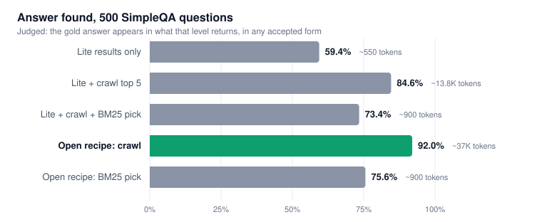

# Keiro Lite search on SimpleQA

An open benchmark of Keiro's `/search/lite` endpoint on 500 SimpleQA questions: how often the answer shows up in what Lite returns, and how far an open, no-model recipe on top of it gets. Every line of the pipeline is in [`bench_lite.py`](bench_lite.py), and every question's result is in [`results/`](results/).



**With the open recipe below, the answer is in Lite's results plus the crawled pages for 460 of 500 questions (92.0%).** Lite's titles and snippets alone hold it 59.4% of the time.

## Results

| Level | What runs | Answer found | Exact match | Tokens to read | Median latency |
|---|---|---|---|---|---|
| **L0** | Lite results only (10 titles + snippets) | 59.4% | 53.8% | ~550 | 1.8 s |
| **L1** | L0 + Lite's top 5 pages, crawled | 84.6% | 81.2% | ~13,800 | 6.9 s |
| **L2** | L1, then BM25 picks the best ~900 tokens | 73.4% | 69.2% | ~900 | 6.9 s |
| **Recipe L1** | Open recipe, top 8 pages crawled | **92.0%** | 87.2% | ~37,000 | 9.3 s |
| **Recipe L2** | Open recipe, then BM25 picks ~900 tokens | 75.6% | 68.4% | ~900 | 9.3 s |

*Answer found* is exact match plus the judged variant forms (see [Scoring](#scoring)). *Tokens to read* is everything that level returns, at about 4 characters per token.

The answer was in Lite's first crawled page for 315 of 500 questions with the recipe, and in its first three for 395.

## The open recipe

Four steps on top of plain Lite. Nothing in it uses a model.

1. **Drop results with no readable text.** Video, chat, translation, social and search-engine pages (`youtube.com`, `tiktok.com`, `web.whatsapp.com`, `translate.google.*`, `google.*`, `yandex.*` and a few more). In the first run these took 1 in 5 of the crawl slots on questions that missed.
2. **Ask Lite twice.** Once with the question, once with only its keywords ("Who directed S1E8 of Abstract: The Art of Design?" becomes `directed s1e8 abstract art design`). The lists are merged rank by rank.
3. **Add Wikipedia's own search**, top 3 titles, merged the same way. It is free, and SimpleQA leans on Wikipedia.
4. **Crawl the top 8** of the merged list instead of the top 5.

Each step's effect, measured on the 77 questions plain L1 missed:

| Steps | Misses recovered |
|---|---|
| 1, top 5 | 18 of 77 |
| 1, top 8 | 19 of 77 |
| 1 + 2, top 8 | 43 of 77 |
| 1 + 2 + 3, top 8 (the recipe) | 47 of 77 |

On all 500, the recipe found 50 answers plain L1 missed and lost 13 it had found, for a net of +37.

Cost: two Lite calls per question, which is $0.20 per 1,000 questions at Lite's paid-plan price of $0.10 per 1,000, plus your own crawling.

## The crawler

1. `curl_cffi` GET with Chrome's TLS fingerprint, text extracted with `trafilatura` (tables kept, recall favored).
2. If that fails, or the page is a JavaScript shell or a bot wall: headless Chromium through Playwright, with images, fonts and CSS blocked.
3. 9 seconds per page for both tiers together. After that the page counts as blocked.

Extraction runs in worker processes, because `lxml` is not safe to run in several threads at once.

Across the recipe run's 3,981 page fetches: 75% came through on plain HTTP, 9% needed the browser, 14% were blocked and 3% timed out.

## Scoring

- **Exact match:** the gold answer, lowercased with punctuation and articles removed, is a substring of the level's text.
- **Answer found:** exact matches, plus misses that an LLM judge (`minimax/minimax-m3.1-flash`, minimal reasoning) accepts. The judge reads the text around the gold answer's rarest words. It counts variant forms: date order, abbreviations, numerals vs words, transliterations, paraphrases, and compound answers with every part stated. It does not count answers you would have to compute, partial answers or different values. Its prompt is in `judge()`.

This only measures whether the answer is **present** in what comes back, not whether a model reading it would answer correctly.

## Sample

500 questions from [OpenAI's SimpleQA test set](https://openai.com/index/introducing-simpleqa/): `random.seed(42)`, then `random.sample(rows, 1500)[1000:1500]`. None of these questions were used while building or tuning the recipe; the step-by-step table above was measured on the first run's misses, and the recipe's number comes from a full rerun of all 500.

## Read this before quoting the numbers

- **Runs vary.** L0 is the same thing in both runs and scored 59.4% in the first and 65.0% in the second. Lite's results and which pages load both change between runs, so treat any single number as roughly ±3 points.
- **92.0% means reading about 37,000 tokens.** Picking the best 900 tokens with BM25 drops it to 75.6%. Closing that gap takes a ranking model; our [deep endpoint](https://github.com/Keirolabs-API/deep-search-benchmark) does that.
- **Latency is unoptimized.** In the recipe the keyword call and the Wikipedia search start after the first Lite call returns. Running all three at once would cut about 2 seconds.

## Run it

```bash
docker build -t lite-bench .

# plain Lite (L0, L1, L2)
docker run --rm --shm-size=1g -e KEIRO_API_KEY -e OPENROUTER_API_KEY \
  -v $PWD/data:/data -v $PWD/out:/out lite-bench

# with the open recipe
docker run --rm --shm-size=1g -e KEIRO_API_KEY -e OPENROUTER_API_KEY \
  -e FILTER=1 -e VARIANT=1 -e WIKI=1 -e CRAWL_K=8 \
  -v $PWD/data:/data -v $PWD/out:/out lite-bench
```

`KEIRO_API_KEY` comes from [platform.keirolabs.cloud](https://platform.keirolabs.cloud); `OPENROUTER_API_KEY` runs the judge. The SimpleQA CSV downloads on first run.

| Variable | Default | |
|---|---|---|
| `N`, `SEED`, `OFFSET` | 500, 42, 1000 | Which questions |
| `CRAWL_K` | 5 | Pages crawled per question |
| `BUDGET` | 1000 | Token budget for the BM25 pick |
| `FILTER`, `VARIANT`, `WIKI` | 0 | Recipe steps 1, 2 and 3 |
| `CONC` | 4 | Questions in parallel |
| `QIDS` | | JSON list of questions to run only those |
| `JUDGE_MODEL` | `minimax/minimax-m3.1-flash` | |

## Files

- [`bench_lite.py`](bench_lite.py): the whole benchmark, crawler and judge included
- [`results/baseline_500.json`](results/baseline_500.json): plain Lite run, with per-question URLs, crawl tier per page, timings, tokens and verdicts per level
- [`results/recipe_500.json`](results/recipe_500.json): the recipe run, same fields
- [`results/ablation/`](results/ablation/): the step-by-step runs on the 77 misses, and the questions list
- [`assets/headline.svg`](assets/headline.svg): the chart above

## License

MIT. SimpleQA is © OpenAI, MIT-licensed.
